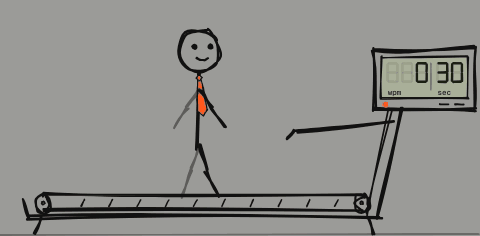

# treadmill

A 30-second typing test where a scribbly stick figure runs on a treadmill as fast as you type, and trips over every typo. Part of [cosmo030.com](https://cosmo030.com).



Play it at [treadmill.cosmo030.com](https://treadmill.cosmo030.com). Companion game: [hangman](https://hangman.cosmo030.com).

## How it works

- **The timer starts on your first letter** and runs for 30 seconds. Tab or Enter (or the restart button) starts over with fresh words at any time.
- **The runner's speed follows your live WPM**: standing (and blinking) at 0, walking under 30, jogging to 60, running and leaning forward to 90, sprinting with a sweatband and speed lines above that. The gait blends smoothly between speeds, but the frames step through six keyframes like a flipbook.
- **Every wrong letter is a stumble.** The figure pitches forward, flails, and catches itself on an overshoot spring (~350 ms). Three typos within 1.5 s make a bigger stumble with a panicked face. A new typo restarts the stumble instead of stacking.
- **At the end** the treadmill winds down and the figure bends over panting, or throws its arms up if you set a new personal best.
- Drawn with [Rough.js](https://roughjs.com) on a `<canvas>`, redrawn about 10 times a second with cycling seeds so the lines "boil", like [hangman](https://hangman.cosmo030.com). With `prefers-reduced-motion`, the boil, shaking and dust are gone and the stride is slow and simple; the console and running vs standing still show.

### WPM and accuracy

- **WPM** = characters in correctly typed words, plus the space after each one, ÷ 5 ÷ minutes. A word only counts if it's typed exactly right (fixing it with backspace is fine). A word that's fully typed when time runs out counts too, without a space. Rounded to a whole number.
  Example: 10 × `the` in 30 s → (10 × 4) ÷ 5 ÷ 0.5 = **16 WPM**.
- **Accuracy** = correct keystrokes ÷ all keystrokes. Letters and spaces count as keystrokes, backspace doesn't. A space after a wrong or unfinished word is a wrong keystroke. Rounded down, so one mistake never shows 100%.
- **Stumbles** = wrong letter keystrokes (including extra letters past the end of a word). Backspacing doesn't take one back.
- **Live WPM** (the console and the runner) = correct keystrokes in the last 3 seconds, smoothed so it doesn't jitter.

Your best WPM is kept in `localStorage` under `treadmill.v1`. Nothing leaves the browser: no backend, no analytics.

## Local setup

```bash
npm i
npm run dev         # http://localhost:5173
npm run typecheck   # tsc --noEmit
npm test            # Vitest unit tests
npm run build       # typecheck + production build into dist/
```

## Stack

TypeScript (strict, `noUncheckedIndexedAccess`), Vite, Rough.js, Vitest. Static site on Vercel.

## Layout

```
src/
  main.ts      app setup, UI, keyboard + phone input, results, theme
  game.ts      ready → running → finished, the 30 s clock, live WPM
  typing.ts    word tracking, keystroke counting, stats (pure functions)
  words.ts     300 common words + no-repeat random stream
  poses.ts     run-cycle keyframes, speed → gait, forward kinematics
  runner.ts    Rough.js drawing: treadmill, LCD console, figure, stumbles
  spring.ts    overshoot spring (ported from hangman)
  results.ts   personal best + share text
  types.ts     shared types
tests/         unit tests
public/        favicon, Open Graph image
```
